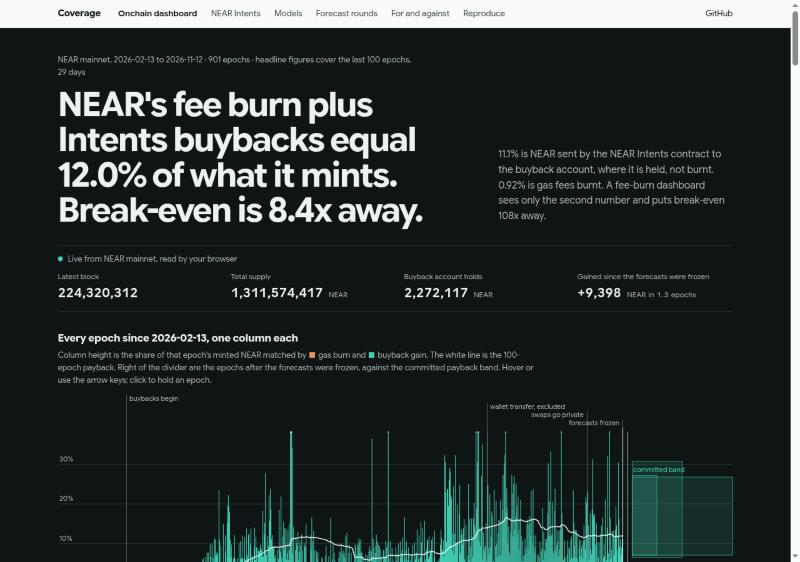
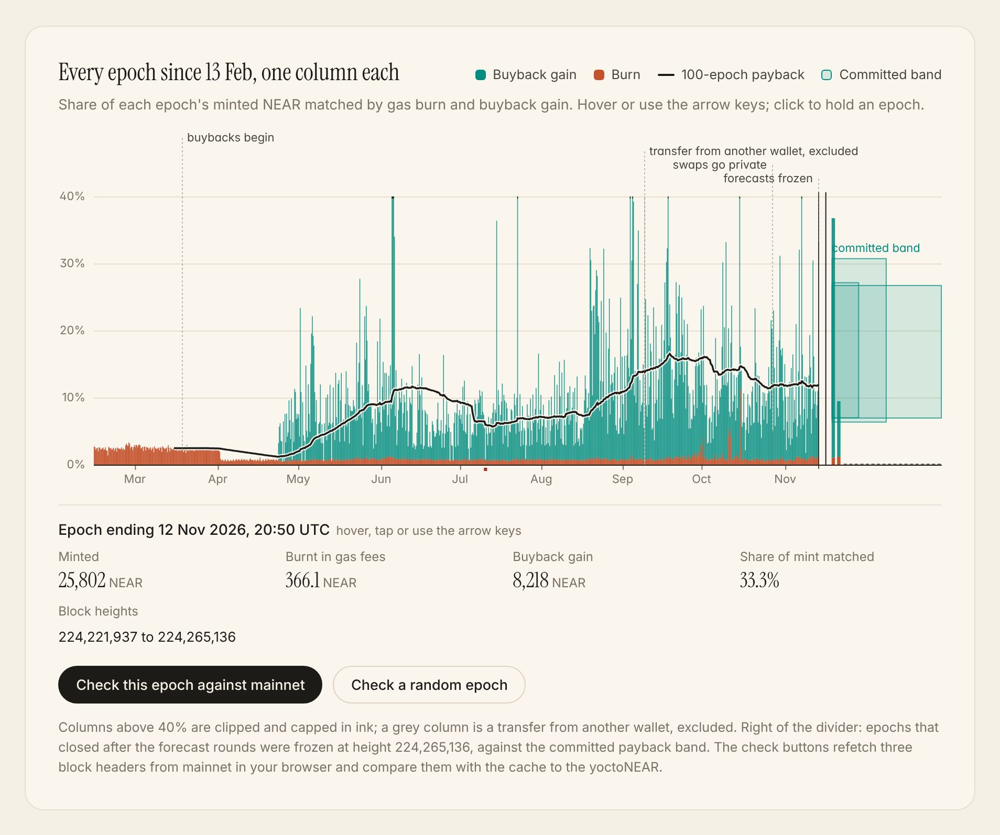
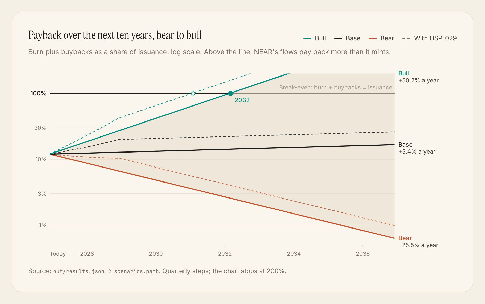
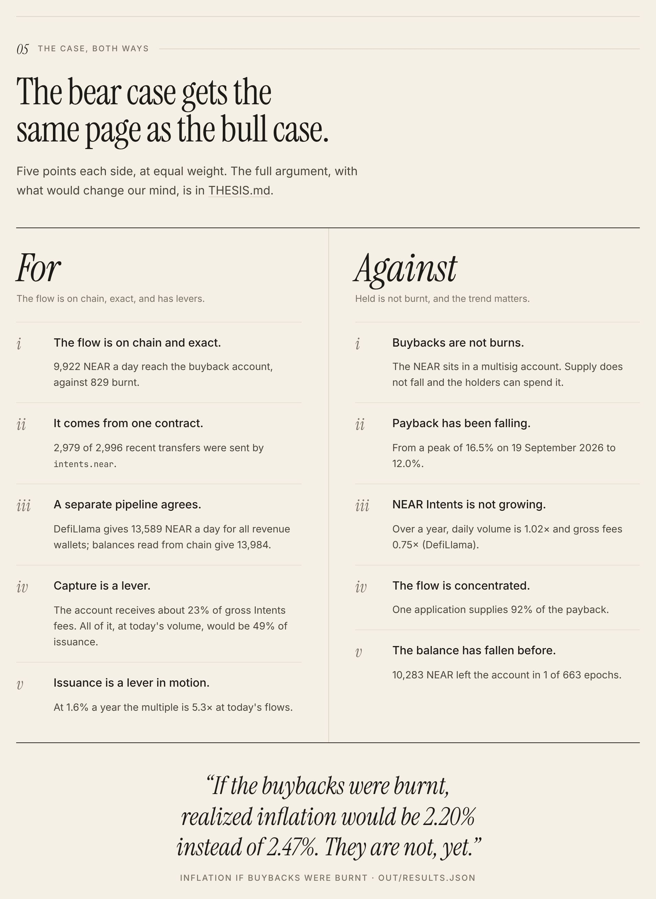
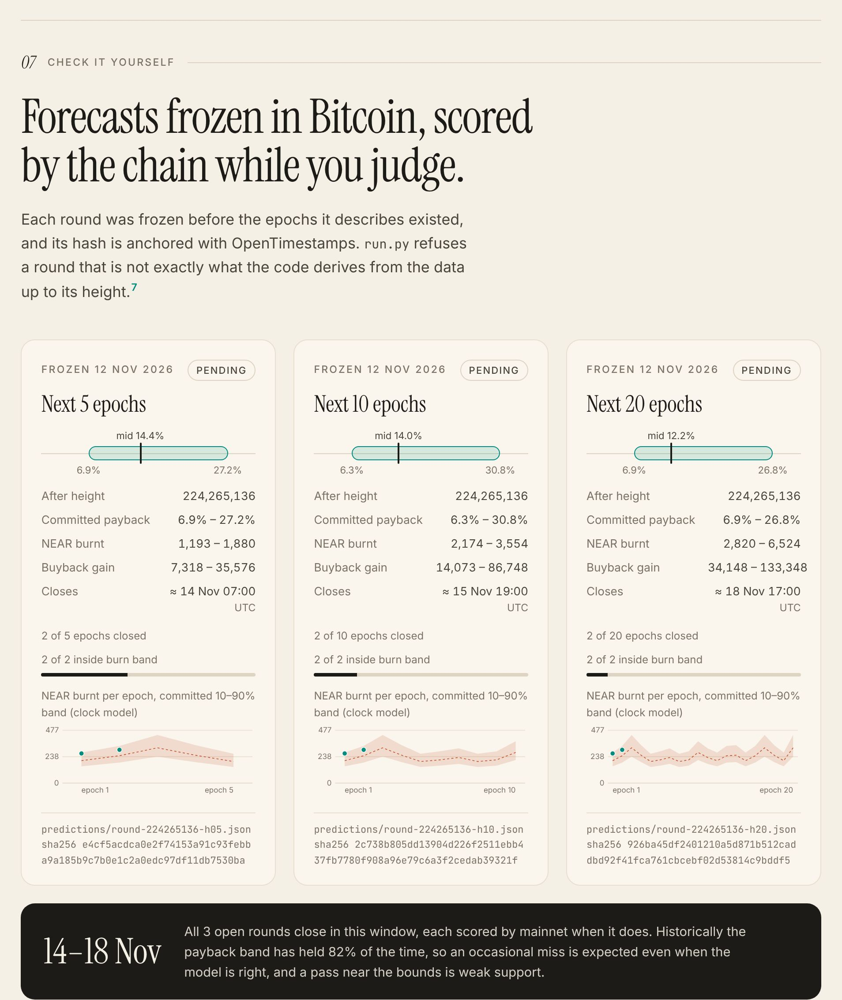

# Coverage

How much of NEAR's token issuance is offset by protocol flows, and how far is break-even?

[](https://github.com/nice-bills/Coverage/actions/workflows/pages.yml)

Live dashboard: https://nice-bills.github.io/Coverage/

**Short on time? [Coverage in 60 seconds](https://nice-bills.github.io/Coverage/quick.html)**: six steps, one idea each, plain words.

It runs itself. Every 6 hours a scheduled job fetches the epochs that closed, scores the frozen
forecast rounds and redeploys. About once a day it freezes a new round, timestamps it in Bitcoin
and commits it. Nobody edits the numbers by hand.



## The result in five lines

- NEAR mints about 2.5% of its supply a year. The gas-fee burn gives back 0.92% of that, so
  on burn alone flows would have to grow 108x to equal issuance.
- Since April 2026 the NEAR Intents contract has also sent NEAR to a buyback account. Burn plus
  that flow equals 12.0% of issuance: flows would have to grow 8.4x, not 108x.
- The case against, with equal weight in [THESIS.md](THESIS.md): buybacks are held, not burnt,
  and the 100-epoch payback has fallen from its 16.5% peak to 12.0%.
- Path to break-even (THESIS.md): at the median year-long Intents growth in the data (+3.4%
  a year), burn plus buybacks reach issuance in 2091 (2077 with HSP-029);
  at the year's best trend (+50.2%) in 2032; at the worst (−25.5%), break-even never comes, because the flow shrinks.
- Every number above is rebuilt offline by `python3 run.py` and checked against mainnet by
  `python3 verify.py`; forecasts frozen before judging are scored by the chain during it.

## The dashboard in four pictures

Every epoch since February, with the 100-epoch payback and the frozen forecast bands on the right:



The path to break-even, bear to bull, with and without HSP-029:



The case for and against, at equal weight:



Forecasts frozen before the epochs existed, scored by mainnet while you judge:



## Where each track requirement is met

Track: Investment Thesis (id `thesis`): "Build a long-term investment thesis for NEAR and back it
with onchain analytics, live dashboards and models anyone can re-run. The score depends on
evidence someone else can reproduce."

| Requirement | Where | Honest note |
|---|---|---|
| Onchain analytics from public data | `fetch.py`: mint and burn from `total_supply` in block headers for every one of 901 epochs; buyback balance by `view_account` | Free keyless endpoints; a full rebuild takes hours because they rate-limit |
| An Intents data pull | `data/inflows.csv` (transfers into the buyback account, with senders) and `data/llama.csv` (DefiLlama's public NEAR Intents volume and fee series) | Third-party (NearBlocks, DefiLlama). They never feed mint, burn, payback or the multiple. No Intents Explorer API pull, on purpose: its terms forbid keeping the data beyond 24 hours (see [BigQuery queries](#network-activity-from-bigquery-needs-a-google-account)) |
| SQL against the NEAR BigQuery public dataset: daily active accounts, transaction counts, contract usage | Four files in `queries/`, each filtered on `block_date` over 2026-02-13 to 2026-11-12, with the bytes it scans and how to run it in its header. Chapter 06 of the dashboard draws each result with its SQL and one sentence written from the data | the queries are written; their results are not committed yet, so the dashboard shows each query with its SQL and no chart. They never feed the headline numbers or the result hash. The results stay out of `out/results.json`, so the hash never depends on them |
| One command rebuilds every figure | `python3 run.py`, offline, under 2 seconds, prints a hash that must match this file | Rebuilds from the committed cache; `verify.py` compares the cache with mainnet |
| A dashboard: each chart, its method, one sentence | `dist/index.html`, live at the link above: every chart is titled with its finding and carries its source. It draws every epoch as one column, reads the current block and buyback balance from mainnet in your browser, and its "Check a random epoch" button refetches three block headers and compares mint, burn and the buyback gain with the cache to the yoctoNEAR. Its "Check it yourself" chapter shows the recorded output of `run.py` and `test_run.py` from the build that produced the page, with a link to that run's GitHub Actions log | One static file, no build step; only the fonts load from Google Fonts, with system fallbacks. The live parts call a free keyless RPC from the browser and say so when it rate-limits |
| Reproducible models | Four, listed on the dashboard under Models with the `run.py` functions behind each | The burn forecasters' bands are too narrow (about two-thirds held against a nominal 80%); stated, not hidden |
| Claim, evidence for, evidence against, what would change our mind | [THESIS.md](THESIS.md), generated from the results | The case against has equal weight; the headline counts held buybacks, which are not burns |
| An audit of the account the thesis rests on | `run.py` reconciles all 3,374 receipts of the buyback account against balances read from the chain: 658 of 658 transfer-only epochs match to the yoctoNEAR. It also lists who pays in, what left and who can move it ([THESIS.md](THESIS.md), "audited the way a short seller would") | Receipts come from a third-party index (FastNear); balances come from the chain. 5 epochs with multisig calls differ by 0.34 NEAR of gas |
| A check of the private-settlement shift from raw blocks | `fetch.py private`: `intents.near` event logs in seeded random blocks; the share naming the Confidential Intents treasury was 13% before 2026-10-27 and 43% since | Counts events, not dollars; the treasury account id comes from the Tideline entry |
| Evidence someone else can check | Result hash, tamper tests (`test_run.py`), seeded mainnet check (`verify.py`), forecast rounds timestamped in Bitcoin and scored by the chain | The rounds test that the flow persists over days. They do not test the multi-year case |

Coverage measures three flows on NEAR mainnet: NEAR minted to validators, NEAR burnt in gas fees,
and NEAR gained by `buybacks.multisignature.near`, the account that receives NEAR from the NEAR
Intents contract. Mint and burn come from block headers. It needs no API key, no cloud account
and no dependencies beyond Python 3.9+.

Since 2026-10-27 a growing share of Intents swaps settles privately (reported by another entry,
Tideline), which hides fees from public swap data. The buyback account is a mainnet balance and
still shows them: 10,452 NEAR a day since, against 9,298 in the 30 days before. In
our own sample of mainnet blocks the share of `intents.near` event logs that name the private
treasury went from 13% to 43%.

Result for the 100 epochs ending 2026-11-12: burn plus buybacks equal 12.0% of issuance
(burn alone: 0.92%). The thesis, the evidence against it and what would change our mind
are in [THESIS.md](THESIS.md).

## Reproduce (offline, under 2 seconds)

```
python3 run.py
```

Expected last line:

```
RESULT sha256=544723ab97176cc67caa0faf7dc040e0ae524df38a60d7164ee4669942a4fb9b
```

The command reads the files in `data/`, checks that the cached epochs chain together, writes
`out/results.json` and `dist/index.html`, and prints every headline number. Open
`dist/index.html` in a browser for the dashboard: the flows to scale, the onchain charts with
their sources, the four models, the forecast rounds and the commands on this page. Both output files are also committed, so they
can be read without running anything.

It also prints `LEDGER` lines: each frozen forecast round in `predictions/`, scored against the
cached epochs that closed after it.

## Self-test (offline, about 2 seconds)

```
python3 test_run.py
```

Expected output: `SELFTEST PASS`. It tests the scoring maths, then runs `run.py` on a copy of
the repo and confirms that (a) the result hash is unchanged once rounds are frozen, (b) a frozen
round cannot be rewritten, (c) an edited round is refused, and (d) one yoctoNEAR added to one
cached row is refused.

## Check that the prose matches the data (offline)

```
python3 docs.py --check
```

Expected output: `DOCS IN SYNC from result <first 12 characters of the hash above>`. This file,
`THESIS.md` and `SUBMISSION.md` are generated from `templates/` by `docs.py`; every measured
figure in them is filled in from `out/results.json`, so those figures cannot drift from the
data. Dates and governance facts (the buyback start date, HSP-029) are not computed here; each
is cited to its source in `THESIS.md` and is true as of 2026-11-13.

## Network activity from BigQuery (needs a Google account)

The track asks for SQL against `bigquery-public-data.crypto_near_mainnet_us`. The four queries are
in `queries/`. Each reads only the columns it needs and filters on `block_date`, the column the
tables are partitioned on, so BigQuery reads only the days in the window.

| Query | Measures | Table | Result |
|---|---|---|---|
| [`queries/daily_active_accounts.sql`](queries/daily_active_accounts.sql) | Daily active accounts: distinct transaction signers per UTC day | `transactions` | pending |
| [`queries/daily_transactions.sql`](queries/daily_transactions.sql) | Transactions included on chain per UTC day | `transactions` | pending |
| [`queries/intents_share.sql`](queries/intents_share.sql) | Contract usage: receipts and function calls per day, and how many went to intents.near | `receipt_actions` | pending |
| [`queries/top_contracts.sql`](queries/top_contracts.sql) | Contract usage: the 25 contracts with the most function calls, first and last 30 days of the window | `receipt_actions` | pending |

Status: the queries are written; their results are not committed yet, so the dashboard shows each query with its SQL and no chart. They never feed the headline numbers or the result hash.

To run them (free, no card):

1. Open https://console.cloud.google.com/bigquery and accept the BigQuery sandbox.
2. Paste one file from `queries/`. The editor shows how many bytes it will process; the
   sandbox allows 1 TB a month and the four together fit.
3. Run, then **Save results → CSV (local file)**, and save it as `data/bq/<query name>.csv`.
4. `python3 run.py && python3 docs.py`. The dashboard's chapter 06 and this section fill in.

With the Cloud SDK instead:

```
mkdir -p data/bq
for q in daily_active_accounts daily_transactions intents_share top_contracts; do
  bq query --use_legacy_sql=false --format=csv --max_rows=1000 < queries/$q.sql > data/bq/$q.csv
done
```

`bq.py` reads the CSVs with the standard library. A missing file leaves its chart "pending" and
breaks nothing; a malformed one makes `test_run.py` fail. `run.py` does not read them, so the
result hash above does not change when they are added.

Why there is no Intents Explorer API pull: the brief suggests one, but the 1Click Swap API Terms
of Use, section 4.1(e) (https://partners.near-intents.org/legal/terms-of-service), forbid keeping
its data beyond 24 hours. A copy committed here so that anyone can recheck the figures would break
those terms, and a pull that cannot be kept cannot be reproduced. NEAR Intents volume and fees
come from DefiLlama's public series (`data/llama.csv`) instead.

## Check the cache against the chain (network, no keys, about a minute)

```
python3 verify.py 3 12345
```

Replace `12345` with any integer you choose. For 3 randomly chosen epochs the script refetches
the epoch from NEAR mainnet and requires every cached field, and the buyback balance at the
epoch's last block, to match. It also checks on two random blocks per epoch that
`total_supply` fell by exactly the fees burnt in that block. Expected last line:

```
VERIFY seed=12345 PASS (3/3 epochs match the chain, 6 blocks checked against their parents)
```

[VERIFY.txt](VERIFY.txt) is the recorded output of one run. The free endpoints rate-limit, so a
run can pause for minutes; it waits and retries for as long as they do. Stop it with Ctrl-C at
any time.

## Score the frozen predictions (network, no keys)

```
python3 fetch.py --epochs 45
python3 run.py
```

`fetch.py` adds only epochs and balances newer than the cache. `run.py` then prints, per round
(illustrative; the committed cache was frozen at the rounds' height, so it prints `0/5`, `0/10`
and `0/20` until `fetch.py` adds the epochs that closed since):

```
LEDGER round-<height>-h10.json: 7/10 epochs closed -> PENDING
LEDGER   payback: <low> to <high>, actual None -> PENDING
```

A round is `PENDING` until all its epochs have closed, then `PASS` or `FALSIFIED`. The
`RESULT sha256` does not change when newer epochs are added, because the analysis stops at the
newest round's height; later epochs are used only for scoring.

## Rebuild the cache from the chain (slow)

```
python3 fetch.py --epochs 901
python3 fetch.py wallets 214890733 214933933
python3 fetch.py inflows
python3 fetch.py protocol
python3 fetch.py offchain
python3 fetch.py history
python3 fetch.py multisig
python3 fetch.py private
```

`fetch.py` skips whatever is already cached, so to rebuild from nothing move `data/` aside
first (`git checkout data/` restores it). `--epochs` counts back from the current chain tip, so
use a number at least as large as shown plus the epochs that have closed since; `run.py`
ignores epochs before or after the frozen range, so extra history does not change the result.
The third-party files (`inflows`, `offchain`) return newer rows on a later day and will change
the hash; keep the committed copies to reproduce it. A full rebuild takes several hours because the free
endpoints allow short bursts and then block for minutes. A rebuild run later also picks up
newer epochs; `run.py` uses those only for scoring.

## What is measured

Every NEAR block header carries `total_supply`. Within an epoch it falls by exactly the fees
burnt in that block; at the first block of an epoch it also rises by the newly minted reward.

| Quantity | Definition | Exact? |
|---|---|---|
| mint | `supply(first block) - supply(last block of previous epoch) + burnt(first block)` | yes, integer yoctoNEAR |
| burn | `burnt(first block) + supply(first block) - supply(last block)` | yes, integer yoctoNEAR |
| buyback gain | change in the NEAR balance of `buybacks.multisignature.near` between epoch ends | yes, as a balance change |
| payback | `(burn + buyback gain) / mint` | yes |
| multiple | `mint / (burn + buyback gain)`: growth in those flows that equals issuance | yes |
| utilization | `gas_used / gas_limit` over 3 seeded random heights per epoch (a skipped height yields no block, so a few epochs have 2) | sampled |
| ceiling | `burn / mint / utilization`: burn coverage scaled to full blocks at today's effective gas price | sampled, extrapolated |

`burnt(block)` is the sum of `balance_burnt` over the chunks included at that height.

A buyback gain larger than 20 times the median of the previous 100 epochs is treated as a
transfer of revenue captured earlier. It is excluded from every figure and reported as
`lump_transfers`. The rule only looks backwards. The headline window contains
0 excluded epochs and 0 outflow epochs, so the headline payback does not
depend on the threshold. One epoch qualifies; `data/wallets.csv` shows
the other revenue wallets falling by nearly the same amount across it.

What the internal check does and does not prove: `run.py` requires each epoch to begin at the
height and supply where the previous one ended, and each row's `mint - burn` to equal its
supply change. That catches gaps, reordering and single edited values. It cannot catch a row
that is wrong in a self-consistent way; `verify.py` compares rows with the chain for that.

## Data

| File | Content | Source | Key |
|---|---|---|---|
| `data/epochs.csv` | one row per epoch: heights, timestamps, supply, mint, burn, gas sample | `block` on `archival-rpc.mainnet.fastnear.com`; `/v0/block/{h}/headers` on `mainnet.neardata.xyz` | none |
| `data/buybacks.csv` | buyback account balance at each epoch end | `query view_account` on the same RPC | none |
| `data/wallets.csv` | NEAR and wNEAR in all three revenue wallets at selected heights | `view_account`, `ft_balance_of` on `wrap.near` | none |
| `data/protocol.json` | protocol parameters cited in the thesis | `EXPERIMENTAL_protocol_config` | none |
| `data/inflows.csv` | recent transfers into the buyback account, with sender and transaction hash | NearBlocks API (third party) | none |
| `data/wallet_history.csv` | every receipt to or from the buyback account, exact yoctoNEAR | FastNear transaction index (third party); `run.py` reconciles it against `buybacks.csv` | none |
| `data/multisig.json` | who can move the buyback account: confirmations required, keys, requests, at one pinned height | `call_function`, `view_access_key_list`, `view_account` on the same RPC | none |
| `data/private_sample.csv` | `intents.near` event logs in 500 seeded random blocks, 250 before and 250 since 2026-10-27 | `/v0/block/{h}` on `mainnet.neardata.xyz` | none |
| `data/llama.csv` | daily USD: NEAR fees, NEAR Intents volume, fees, captured revenue | DefiLlama API (third party) | none |
| `data/price.csv` | daily NEAR price in USD | CoinGecko API (third party) | none |
| `data/bq/*.csv` (optional) | results of `queries/*.sql`: daily active accounts, transactions, Intents share of receipts, top contracts | BigQuery public dataset `bigquery-public-data.crypto_near_mainnet_us` | a Google account (sandbox is free) |

`data/sources.json` records, for every file in `data/`, when it was written, from which
URLs, and its sha256; `test_run.py` fails if a file does not match its recorded hash. The two header sources return identical fields and `fetch.py` alternates between them. The
third-party files never feed mint, burn, buyback gain, payback or the multiple. They are used
for sender attribution, a cross-check table, the price-based forecasting model and USD context.

## Forecasts and the outside judge

Each file in `predictions/` is a round, written by `python3 run.py freeze <epochs>` from the
newest cached epoch and never overwritten. The scheduled job (`.github/workflows/pages.yml`) runs
`python3 run.py freeze-if-due 5`, which freezes a 5-epoch round once three epochs have closed
since the newest one, so a round closes almost every day. A round commits to bands (the 5% to 95% range of past window-to-window changes) for payback, total
NEAR burnt and total NEAR gained by the buyback account over the next `<epochs>` epochs, plus
per-epoch burn forecasts from three models (`persistence`, `clock`, `price`).

| Round | Epochs | Expected to close (UTC) | Payback | NEAR burnt | Buyback gain, NEAR | Payback interval held in the past | sha256 |
|---|---|---|---|---|---|---|---|
| `round-224265136-h05.json` | 5 | about 2026-11-14 07:00 | 6.9% to 27.2% | 1,193 to 1,880 | 7,318 to 35,576 | 134 of 168 | `e4cf5acdca0e2f74153a91c93febba9a185b9c7b0e1c2a0edc97df11db7530ba` |
| `round-224265136-h10.json` | 10 | about 2026-11-15 19:00 | 6.3% to 30.8% | 2,174 to 3,554 | 14,073 to 86,748 | 71 of 83 | `2c738b805dd13904d226f2511ebb437fb7780f908a96e79c6a3f2cedab39321f` |
| `round-224265136-h20.json` | 20 | about 2026-11-18 17:00 | 6.9% to 26.8% | 2,820 to 6,524 | 34,148 to 133,348 | 35 of 40 | `926ba45df2401210a5d871b512caddbd92f41fca761cbcebf02d53814c9bddf5` |

Rule, checked by `run.py` once a round's epochs have closed:

- payback inside its interval: `PASS`; outside: `FALSIFIED`;
- the other two claims: `HIT` or `MISS`.

`out/results.json` records under `claims_backtest` how often the same procedure held at earlier
dates. Each round file has an OpenTimestamps proof beside it (`.ots`), anchoring its sha256 in
Bitcoin: `ots verify predictions/<file>.ots`. `run.py` refuses a round that is not exactly what
the code derives from the data up to that round's height.

## Files

| File | Role |
|---|---|
| `fetch.py` | chain and indexers to `data/`; resumable; needs network |
| `run.py` | `data/` to results, predictions, ledger and dashboard; offline, deterministic |
| `queries/`, `bq.py` | SQL for the NEAR BigQuery public dataset, and the stdlib loader for its CSV results (dashboard chapter 06) |
| `dashboard.py` | renders `dist/index.html` and writes into it the output `run.py` printed; fonts from Google Fonts, nothing else external |
| `record.py` | runs a command and saves its output (`out/selftest.json`) for the dashboard |
| `verify.py` | spot-checks cached epochs against the chain |
| `docs.py`, `templates/` | generate this file, `THESIS.md` and `SUBMISSION.md` from the results |
| `test_run.py` | self-test and tamper checks |
| `predictions/` | the frozen forecast rounds and their OpenTimestamps proofs |
| `VERIFY.txt` | recorded output of one `verify.py` run |
| `THESIS.md` | claim, evidence for and against, what would change our mind |
| `.github/workflows/pages.yml` | rebuilds the hosted dashboard every 6 hours without changing `main` |

## Limits

- Buybacks are held by a multisig account, not burnt. They do not reduce supply and could be
  spent. Payback is a comparison of flows, not a change in supply: supply keeps growing at the
  gross issuance rate unless the held NEAR is burnt. "Break-even" here means the flows
  are equal, not that supply stops growing.
- The buyback figure covers one of three revenue wallets. The all-wallet figure is in the
  cross-check table.
- A balance change is exact, but that the NEAR was bought with fee revenue rests on NEAR's own
  description of the wallet and on the sender being `intents.near`.
- `data/wallets.csv` shows zero wNEAR for all three wallets at every height queried. That is
  what `ft_balance_of` on `wrap.near` returned; a failed call stops `fetch.py` and is never
  written as zero.
- The scheduled job refetches epochs, buyback balances and the account's receipts. DefiLlama
  and price stay at the committed snapshot, so the price model in rounds frozen later uses the
  last cached price. A round's verdict depends on the payback band, which does not use price.
- Once a new round is frozen, the headline window moves to that round's height, so the result
  hash changes about daily. The job regenerates this file in the same commit.
- Utilization and the ceiling come from 3 blocks per epoch and are only meaningful as 100-epoch
  figures. The ceiling assumes today's effective gas price and is not a capacity guarantee.
- Floats in `out/results.json` are rounded to 6 significant figures so the hash does not depend
  on the platform's maths library.

## Licence

MIT. See [LICENSE](LICENSE).
